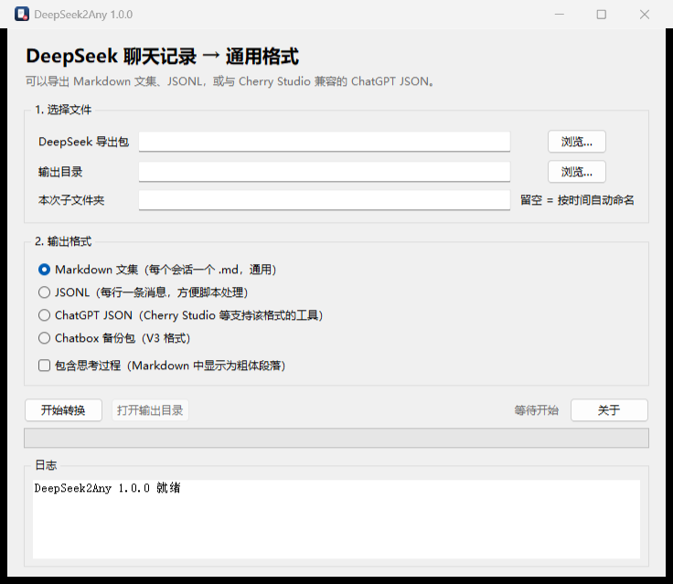

# DeepSeek 聊天记录转换器 · DeepSeek Chat Converter

把 **DeepSeek 导出包**转换成通用聊天记录格式：Markdown 文集、JSONL、ChatGPT JSON，或 **Chatbox 原生备份包**。程序名：`DeepSeek2Any.exe`。




> 纯本地运行：不联网、不上传、不需要安装 Python。

## 为什么会有这个工具

DeepSeek C 端开始限额后，很多人把聊天记录迁到 API 客户端。Cherry Studio 有专门的转换工具（[DeepSeek2Cherry](https://github.com/CaZaYa/deepseek-chat-history-migrator)），而其他客户端各有各的格式：Chatbox 只认自己的备份包，Open WebUI / LibreChat 认 ChatGPT 导出，有些工具干脆没有导入功能。这个工具负责把 DeepSeek 的导出包拆成通用格式，按需输出。

## 支持的输出格式

| 格式 | 产物 | 适合谁 |
| --- | --- | --- |
| `markdown` | 每个会话一个 `.md` 文件 | 任何编辑器、笔记软件、知识库 |
| `jsonl` | 每行一条消息 | 脚本处理、数据集、二次转换 |
| `chatgpt` | `conversations-*.json` | Cherry Studio 等支持 OpenAI 导出格式的工具 |
| `chatbox` | `chatbox-backup-*.zip` | Chatbox（设置 → 数据管理 → 恢复），已实测导入 |

## 各客户端适用平台

| 客户端 | 平台 | 支持的导入格式 | 用本工具生成 |
| --- | --- | --- | --- |
| Cherry Studio | Windows / macOS / Linux | ChatGPT `conversations.json` | `--format chatgpt` |
| Chatbox | Windows / macOS / iOS / Android | Chatbox 备份 V3（zip） | `--format chatbox` |
| Open WebUI | 自建 Web（Docker 等） | ChatGPT `conversations.json` | `--format chatgpt` |
| LibreChat | 自建 Web（Docker 等） | ChatGPT / Claude / ChatbotUI JSON | `--format chatgpt` |
| RecurseChat | macOS / iOS | ChatGPT 历史记录 | `--format chatgpt` |
| Jan | Windows / macOS / Linux | 无原生 ChatGPT 导入 | 暂无，需要单独适配 |

> Open WebUI、LibreChat、RecurseChat 仅验证了输出格式与它们的官方导入格式一致，未逐台实测；Chatbox 与 Cherry Studio 已实际导入成功。

## 快速开始

### 1. 从 DeepSeek 导出

网页版左下角头像 → **系统设置** → **数据管理** → **导出所有历史对话**，下载 `deepseek_data-日期.zip`。

### 2. 转换

双击 `DeepSeek2Any.exe`：选择导出包 → 选择输出目录 →（可选）填写本次子文件夹名 → 选择格式 → 开始。

每次转换都会在输出目录下新建一个子文件夹（默认按时间命名，重名自动加 `-2`），不会覆盖上一次的结果。

### 3. 导入目标客户端

- **Chatbox**：设置 → 数据管理 → 备份 / 恢复 → 选择 `chatbox-backup-*.zip`
- **Cherry Studio**：设置 → 数据 → 导入外部应用数据 → 导入 ChatGPT 数据
- **Open WebUI / LibreChat**：在其设置里选择 Import / 导入，选择 `conversations-*.json`
- **Markdown**：不需要导入，直接用编辑器打开

## 关于 Chatbox

- 备份只包含会话本身，不含设置、Copilot 和凭据，因此不会携带 API Key
- 会话模型记为 `deepseek / deepseek-chat`；如果 Chatbox 没配该模型，历史仍能打开，继续发消息前在输入框重新选一次模型
- **限制**：只保留当前活跃分支（重新生成掉的旧答案不导入）；图片只保留 `[图片：文件名]` 标记，**不导入原图**
- 重复导入同一个包会按会话 ID 覆盖，不会产生重复会话

## 命令行（可选）

最省事的方式：**把导出的 zip 直接拖到 `DeepSeek2Any-CLI.exe` 图标上**，按提示选择格式。

也可以在终端里执行：

```bash
DeepSeek2Any-CLI.exe <导出包.zip> <输出目录> --format markdown
DeepSeek2Any-CLI.exe <导出包.zip> <输出目录> --format jsonl --with-thinking
DeepSeek2Any-CLI.exe <导出包.zip> <输出目录> --format chatgpt
DeepSeek2Any-CLI.exe <导出包.zip> <输出目录> --format chatbox
DeepSeek2Any-CLI.exe <导出包.zip> <输出目录> --format markdown --name 我的备份
```

`--with-thinking` 会把思考过程一起导出；`--name` 指定本次子文件夹名，省略则按时间命名。

## 常见问题

**Q：Chatbox 里为什么看不到图片？**  
Chatbox 备份只保存消息和文件引用。本工具目前保留 `[图片：文件名]` 标记，不写入图片资源。

**Q：Markdown 里的思考过程在哪里？**  
默认不导出，加 `--with-thinking` 或在界面勾选后才会带上。

**Q：ChatGPT JSON 能导入 Chatbox 吗？**  
不能，Chatbox 只认自己的备份格式，请用 `--format chatbox`。

**Q：会上传我的聊天记录吗？**  
不会，全程本地处理，没有任何网络请求。

**Q：输出会覆盖上次的文件吗？**  
不会。每次转换都新建子文件夹，默认按时间命名。

## 隐私与安全

- 不联网、不上传、不写注册表、不需要管理员权限
- 只读取你选择的 zip，写入你选择的输出目录
- 生成的 Chatbox 备份不包含凭据和设置

## 已知限制

- 只支持 DeepSeek 的 `export_format_version: 3` 导出包
- 不提取附件原件，只保留文件名标记
- Chatbox 备份只保留活跃分支，图片不导入原图
- exe 未做代码签名，首次运行可能被 SmartScreen 提示

## 从源码运行与构建

需要 Python 3.9+。

```bash
python -m dsc2any                     # 图形界面
python -m dsc2any <zip> <out> --format chatbox   # 命令行
python -m unittest discover -s tests   # 运行测试
build.bat                              # 打包 exe 到 dist/
```

## 使用手册

- [中文 PDF](docs/使用说明.pdf) · [中文 Word](docs/使用说明.docx)
- [English PDF](docs/User%20Guide%20%28EN%29.pdf) · [English Word](docs/User%20Guide%20%28EN%29.docx)

## 示例数据

`samples/` 下是两份完全虚构的数据：

- `示例DeepSeek导出.zip`：6 段对话，覆盖思考过程、分支、内容过滤、图片附件、缺失附件
- `示例数据_Chatbox备份.zip`：由上面这份示例生成，可直接在 Chatbox 里试导入

## 反馈与维护

这是个人业余时间维护的小工具，难免有疏漏和没覆盖到的场景。

- 遇到问题、发现 bug、有功能建议、文档写错，都欢迎提 Issue，最好附上系统版本、操作步骤和报错截图
- 也欢迎直接提 PR
- 不保证能及时回复，但都会看
- 使用前请备份 DeepSeek 原始导出包

> This is a small hobby project. Bug reports, feature requests and documentation fixes are welcome via Issues — please include your OS version, steps to reproduce and any error message.

## 许可与声明

MIT License，详见 [LICENSE](LICENSE)。

本项目与 DeepSeek、Chatbox、Cherry Studio 官方无关联，仅为社区工具。请仅处理你自己导出的数据。
